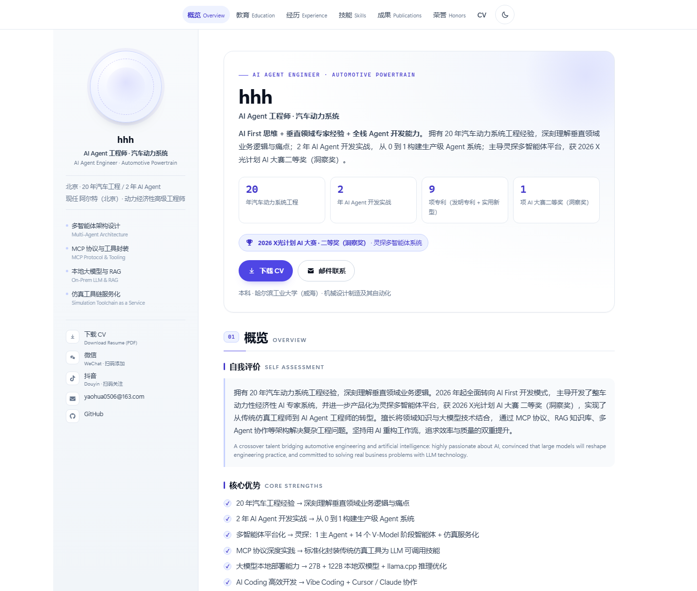

<h1 align="center">
个人简历
</h1>

<div align="center">

[](https://github.com/yaohua0506/yaohua0506.github.io/stargazers)
[](https://github.com/yaohua0506/yaohua0506.github.io/network/members)
[](https://github.com/yaohua0506/yaohua0506.github.io/issues)
[](https://github.com/yaohua0506/yaohua0506.github.io/commits/main)
[](https://github.com/yaohua0506/yaohua0506.github.io)

</div>

<p align="center">纯静态、零依赖的个人简历页面 · 深空极简 + 明暗双主题</p>

<p align="center">
    <br>
    
    <br>
</p>

在线预览：<https://yaohua0506.github.io/>

站点只有 `index.html` + `style.css` 两个代码文件，加上 `img/` 下的本地图片，不加载任何 CDN、字体或前端框架，断网双击也能正常打开。

## 主要特点

- **零依赖零请求**: 图标是内联 SVG，字体用系统字体栈，图片全部本地存放，没有任何外部资源请求，首屏无需等待网络。
- **明暗双主题**: 浅色与暗色各一套设计令牌，默认跟随操作系统设置，导航栏右侧的按钮可手动切换并写入 `localStorage`；`<head>` 里的内联脚本在首屏渲染前就确定主题，暗色用户不会看到白闪。
- **项目叙事**: 阿尔特经历拆为 `Part 01` 山子高科 V17 整车开发、`Part 02` 灵探多智能体系统与 `Part 03` 多车型性能开发与仿真平台（北汽影智 A1 四驱增程、P1+P3 仿真平台、奇瑞 VAN），并用纯 CSS 架构图串联「AI 专家系统 → 多智能体平台」的演进；2026 X光计划 AI 大赛二等奖（洞察奖）在首屏、项目段与荣誉区三处呈现。
- **侧栏名片**: 城市、从业年限与当前任职一眼可见；联系方式包含下载 CV、微信、抖音、邮箱与 GitHub，微信和抖音点击后弹出二维码名片。
- **工作经历选项卡**: 阿尔特 / 福田康明斯 / 奇瑞汽车按任职时间倒序排列，桌面吸顶、≤640px 横向滚动，支持方向键切换；关闭 JS 时三家公司内容按顺序全部展开。
- **技术能力选项卡**: AI / LLM · 传统工程 · 工具链三组，与工作经历共用同一套交互逻辑但桌面不吸顶，≤640px 三列等宽排布；关闭 JS 时三组内容全部展开。
- **深空极简**: 浅色白底、暗色近黑底，indigo 单一强调色，四档文字层级、分区编号、卡片化经历，长页面也有清晰的视觉落点。
- **滚动交互**: 顶部阅读进度条、导航自动高亮当前区块、内容滚动淡入，并遵循 `prefers-reduced-motion` 自动降级。
- **响应式**: 针对 375 / 768 / 1024 / 1440 四档调校；窄屏侧栏回落为顶部区块，表格自动堆叠成卡片；矮屏会自动压缩侧栏间距，避免出现滚动条。
- **打印友好**: `Ctrl + P` 可直接存成 PDF，无论当前是明是暗都强制输出浅色版，并隐藏导航、头像与主题按钮。
- **可访问性**: 语义化标签、`aria-label` 标注星级、`focus-visible` 键盘焦点环、跳转正文的 skip link，正文对比度达到 WCAG AA；二维码弹层基于原生 `<dialog>`，自带焦点圈定与 ESC 关闭。

## 快速开始

1. 克隆本仓库（或直接 fork 后改名成 `USERNAME/USERNAME.github.io`）：

    ```powershell
    git clone https://github.com/yaohua0506/yaohua0506.github.io.git
    ```

1. 打开 `index.html`，按「[内容维护](#内容维护)」一节的对照表替换文字内容。
1. 用你自己的 PDF 覆盖 `Resume.pdf`，**文件名保持 `Resume.pdf`**（大小写敏感），导航栏的 `CV`、首屏的「下载 CV」与侧栏的「下载 CV」都会指向它。
1. 换成真实头像，参考「[换成真实头像](#换成真实头像)」。
1. `commit` 并 `push` 到 `main`，GitHub Pages 约 1 分钟后自动重新构建。

## 页面结构

**布局**：

- **顶部导航**（吸顶，60px）：`概览 · 教育 · 经历 · 技能 · 成果 · 荣誉 · CV`，最右侧是明暗主题切换按钮；滚动时高亮当前区块并显示顶部进度条
- **左侧栏**（宽 300px，`position: sticky; top: 60px`）：头像、姓名、职位、元信息（城市 / 年限 / 现职）、四条方向标签、联系方式（下载 CV / 微信 / 抖音 / 邮箱 / GitHub）
- **右侧栏**：内容区，随页面滚动
- 屏幕宽度小于 900px 时，侧栏回落成顶部区块，导航变成可横向滑动的一行；矮屏（≤780px 高）会隐藏四条方向标签，优先保留元信息与联系方式

**正文**：

| 顺序 | 分区 | 锚点 | 格式说明 |
|---|---|---|---|
| 1 | 概览 Overview | `#about` | Hero 封面 `.hero`（姓名/职位/关键数字/CTA）+ 自我评价引文 `.quote` + 核心优势勾选列表 `.checks` |
| 2 | 教育背景 Education | `#education` | 时间 + 学校 + 专业 + 学位，配校徽 `img/HIT-dark.png` |
| 3 | 工作经历 Experience | `#experience` | 公司选项卡 `.exp-tabs`（阿尔特 / 福田康明斯 / 奇瑞汽车，按任职时间倒序）+ `.exp` 卡片（公司/职位/时间地点）+ 职责表 `.table` + 架构图 `.flow` + 关键成果表；阿尔特段落内用 `Part 01`（山子高科 V17 整车开发）、`Part 02`（灵探多智能体系统）与 `Part 03`（多车型性能开发与仿真平台：北汽影智 A1、P1+P3 平台、奇瑞 VAN）分段，含项目导览 `.anchor-chips`、获奖提示 `.award-callout` |
| 4 | 技术能力 Skills | `#skills` | 分组选项卡 `.skill-tabs`（AI / LLM · 传统工程 · 工具链，不吸顶）+ 分段进度条 `.meter`（`data-v` 控制亮几格）+ 工具链标签 `.tags` |
| 5 | 专利与论文 Publications | `#publications` | 专利表（名称/类型状态/时间/署名）+ 论文 `.pub-list` + 经验报告 `.report-grid` |
| 6 | 获奖与荣誉 Honors | `#honors` | `[A1]` 编号 + 奖项 + 日期 + 角色/颁奖方；2026 X光计划 AI 大赛二等奖（洞察奖）置顶并高亮 |

> 表格在 760px 以下自动堆叠成卡片（`th.t-key` 变成卡片标题，`td[data-label]` 显示字段名）。
> 分区标题的 `01–06` 编号由 CSS 计数器按 DOM 顺序自动生成，增删分区不用手改序号。

## 目录结构

```
.
├── index.html     页面结构 + 全部文字内容 + 内联脚本（主题 / 选项卡 / 弹层 / 滚动交互）
├── style.css      设计令牌 + 明暗双主题 + 组件样式 + 响应式 + 打印样式
├── img/           本地图片：校徽、微信与抖音二维码等
├── screenshot.png README 配图
├── Resume.pdf     简历占位文件，请替换成你自己的（文件名保持不变）
├── .nojekyll      告诉 GitHub Pages 不要用 Jekyll 处理
└── README.md      本文件
```

## 视觉规范

- **明暗双主题**: 所有颜色走 CSS 变量。浅色令牌定义在 `:root`，暗色令牌定义在 `:root[data-theme="dark"]`，由 `<html data-theme="light|dark">` 切换。
- **配色**:
  - 强调色 `--accent: #4f46e5`（indigo）；文字链接与高亮另用 `--accent-strong`，浅色 `#4338ca`、暗色 `#818cf8`，保证深底上的对比度
  - 背景 `--bg` 浅色 `#ffffff` / 暗色 `#0a0a0b`，卡片 `--surface` 浅色 `#ffffff` / 暗色 `#141416`
  - 文字分 `--text / --text-2 / --text-3 / --text-4` 四档
- **主题切换**: 首次访问读 `prefers-color-scheme`，点击导航按钮后写入 `localStorage.theme`，之后以用户选择为准；未手动选择时跟随系统变化。
- **字体**: 系统字体栈 `--font-sans` / `--font-mono`（Segoe UI / PingFang SC / Cascadia Code 等），零外部请求。
- **间距**: 分区之间 `48px`，卡片内边距 `24–26px`，圆角 `10 / 14px`。
- **动效**: 过渡统一 `180–200ms`；滚动淡入由页面底部内联脚本控制，`prefers-reduced-motion: reduce` 时全部关闭。
- **打印**: `@media print` 会用浅色令牌覆盖当前主题，去掉阴影与彩色底，并保证表格分页时不被拆断。

## 内容维护

简历正文唯一来源是 `index.html`，改文字时直接改对应区块即可：

| 要改的内容 | 在 index.html 里找 |
|---|---|
| 姓名 / 英文名 | Hero 里的 `<h1 class="hero-name">`，以及侧栏 `<p class="side-name">`（两处保持一致） |
| 侧栏元信息（城市 / 年限 / 现职） | `<ul class="side-meta">` |
| 左侧方向标签 | `<ul class="side-bio">` |
| 联系方式 | `<ul class="social-icons">`（下载 CV、微信、抖音、邮箱、GitHub） |
| 微信 / 抖音二维码 | 对应 `<a>` 上的 `data-qr`（图片路径）、`data-title`（弹层标题）、`data-alt`（替代文字），图片放 `img/` |
| 关键数字 | Hero 内的 `<ul class="hero-stats">` |
| 求职意向 / 自我评价 | `#about` 下的 `.hero-sub` 与 `.quote` |
| 一段工作经历 | `<article class="exp">`，整块复制/删除 |
| 核心职责 / 关键成果 / 代表项目 / 专利 | `<table class="table table-stack">`，新增行照抄 `<tr>`，首列用 `<th scope="row" class="t-key">` |
| 架构图节点 | `.flow` 内的 `.flow-node`、`.flow-bar` |
| 技能熟练度 | `.meter` 的 `data-v="1~5"`，同时改 `aria-label` |
| 工具链标签 | `.tags` 下的 `<li>` |
| 获奖 / 学历 | `.awards li` / `.edu li` |
| 主题颜色 | `style.css` 顶部的 `:root` 与 `:root[data-theme="dark"]` |
| 更新时间 | 页脚 `.footer` |

**改进度条时**记得同步 `aria-label="熟练度 N 分，满分 5 分"`，否则读屏与打印会不一致。

**加一个新的二维码入口**（例如小红书）只需复制一个 `<li>`，改掉图标、文案和三个 `data-*` 属性，弹层不用动：

```html
<li>
  <svg class="ico" viewBox="0 0 24 24" aria-hidden="true"><path d="..." /></svg>
  <a href="img/xhs-qr.png" target="_blank" rel="noopener"
     data-qr="img/xhs-qr.png" data-title="小红书扫码关注"
     data-alt="小红书二维码，扫码关注">小红书<span class="en">RED · 扫码关注</span></a>
</li>
```

## 换成真实头像

现在的头像是一个带渐变环和虚线圆的装饰性占位（`.avatar` 完全由 CSS 绘制）。换成真实照片：

1. 把照片放到 `img/avatar.jpg`。
1. 把侧栏里的 `<div class="avatar" aria-hidden="true"></div>` 替换为：

    ```html
    
    ```

1. 在 `style.css` 中补一句，让图片裁切填满圆形：

    ```css
    img.avatar { object-fit: cover; object-position: top; }
    ```

`` 是替换元素，原来 `.avatar::before` / `.avatar::after` 画的虚线圆与光晕不会再渲染，不需要额外处理。

## 替换简历

`Resume.pdf` 现在是 858 字节的占位文件。用你自己的 PDF 覆盖它，**文件名保持 `Resume.pdf`**（大小写敏感），
顶部导航的 `CV`、Hero 与侧栏的「下载 CV」都会指向新文件。

## 深浅色主题

- **默认**：跟随操作系统（`prefers-color-scheme`）。
- **手动切换**：点击导航栏右侧按钮，浅色显示月亮、暗色显示太阳，选择写入 `localStorage.theme`。
- **防白闪**：`<head>` 里的内联脚本在样式表加载前就设置 `data-theme`，暗色用户不会先看到白屏再变黑。
- **打印**：`@media print` 强制使用浅色令牌，暗色主题下导出的 PDF 仍是白底黑字。
- **想固定成某一个主题**：把 `<head>` 脚本里的 `data-theme` 直接写死即可，或删除脚本、在 `<html>` 上写死 `data-theme="dark"`。

## 本地调试

1. 直接双击 `index.html`，改完存盘刷新即可，不需要构建步骤。
1. 想模拟手机效果，浏览器开发者工具里切到 375px / 768px 宽度查看。
1. 想检查打印效果，`Ctrl + P` 打开打印预览，A4 纸张下确认分页是否合适。
1. 想检查暗色主题，点击导航栏右侧按钮，或直接给 `<html>` 加上 `data-theme="dark"`。

## 部署方式

- 仓库名必须是 `用户名.github.io`，且为 **Public**
- Settings → Pages → **Source 选 `Deploy from a branch`**，分支 `main`，目录 `/ (root)`
- 每次 `git push` 到 `main`，Pages 会自动重新构建，约 1 分钟生效

日常更新：

```powershell
git add -A
git commit -m "更新内容"
git push
```

## 已知占位

- 侧栏姓名与 Hero 标题当前显示为 `hhh`（匿名版），替换成真实姓名后记得同步 `<title>` 与 `<meta name="description">`
- `Resume.pdf` 仍是占位文件
- 头像是 CSS 绘制的装饰圆，等真实照片就位后按「[换成真实头像](#换成真实头像)」替换
